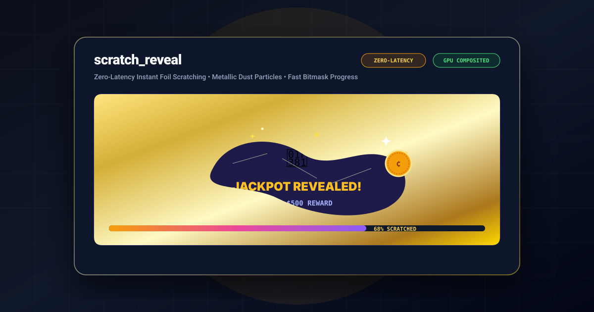

# scratch_reveal

<p align="center">
  <a href="https://pub.dev/packages/scratch_reveal"></a>
  <a href="https://pub.dev/packages/scratch_reveal/score"></a>
  <a href="https://govindtank.github.io/scratch_reveal/"></a>
  <a href="https://pub.dev/packages/scratch_reveal"></a>
  <a href="https://github.com/govindtank/scratch_reveal/actions"></a>
  <a href="LICENSE"></a>
</p>

<p align="center">
  
</p>

An interactive, high-performance scratch-to-reveal card library and turnkey `RewardScratchCard` for Flutter. Features **celebratory confetti bursts, turnkey Google Pay & CRED style voucher rewards, flying metallic foil dust particles, coin serration brushes, and sub-0.1ms spatial bitmask progress calculation**.

---

## ⚡ Key Features

| Feature | Description | Real-World Benefit |
|---|---|---|
| **Turnkey `RewardScratchCard`** | Complete gamified reward card with metallic foil, coupon code, and claim action | Ready in 3 lines of code |
| **Celebratory Confetti Cannon** | Physics-based 2D confetti ribbons bursting upwards upon threshold auto-reveal | Delightful reward moment |
| **Zero-Latency Touch Punch** | Touching or tapping down immediately punches a crisp hole without drag delay | Instant, tactile response |
| **Coin & Rough Brushes** | Realistic coin edge serration with micro-grooves (`ScratchBrushShape.coin`) | Feels like a real coin scratcher |
| **Flying Foil Dust Particles** | Dynamic metallic shaving flakes and sparkle dust that scatter while scratching | Realistic physical sensation |
| **Sub-0.1ms Bitmask Tracking** | Zero heavy bitmap reading; pure 64-bit integer grid bitmasks on CPU | Constant 120 FPS on all devices |

---

## 🚀 Quick Usage

### 1. Turnkey Reward Card (Google Pay / CRED / PhonePe Style)

```dart
RewardScratchCard(
  rewardTitle: '₹ 250 Cashback',
  rewardSubtitle: 'Credited on orders above ₹499',
  couponCode: 'SWIGGY250',
  coverTitle: 'Scratch & Win',
  coverSubtitle: 'Scratch here to reveal your surprise cashback',
  threshold: 0.45,       // Auto-reveal at 45% scratched
  enableConfetti: true,  // Confetti explosion on unlock
  onClaimPressed: () {
    print('Voucher claimed!');
  },
)
```

---

### 2. Lower-Level Custom Scratch Card

```dart
ScratchReveal(
  brushSize: 40.0,
  brushShape: ScratchBrushShape.coin,
  threshold: 0.50,
  autoReveal: true,
  coverGradient: const LinearGradient(
    colors: [Color(0xFFFFD700), Color(0xFFB8860B)],
  ),
  revealedChild: Container(
    color: const Color(0xFF1E293B),
    child: const Center(
      child: Text('🎉 500 COINS WON!', style: TextStyle(color: Colors.white)),
    ),
  ),
  onThresholdReached: () => print('Unlocked!'),
)
```

---

## 💖 Support the Project

If you find this project useful, consider supporting its active maintenance and future development:

<p align="left">
  <a href="https://buymeacoffee.com/govindtanko"></a>
  <a href="https://github.com/sponsors/govindtank"></a>
  <a href="https://www.patreon.com/govindtank"></a>
</p>

---

## 📄 License

This project is licensed under the Apache License 2.0 - see the [LICENSE](LICENSE) file for details.

*Maintained with ❤️ by [Govind Tank](https://github.com/govindtank).*
